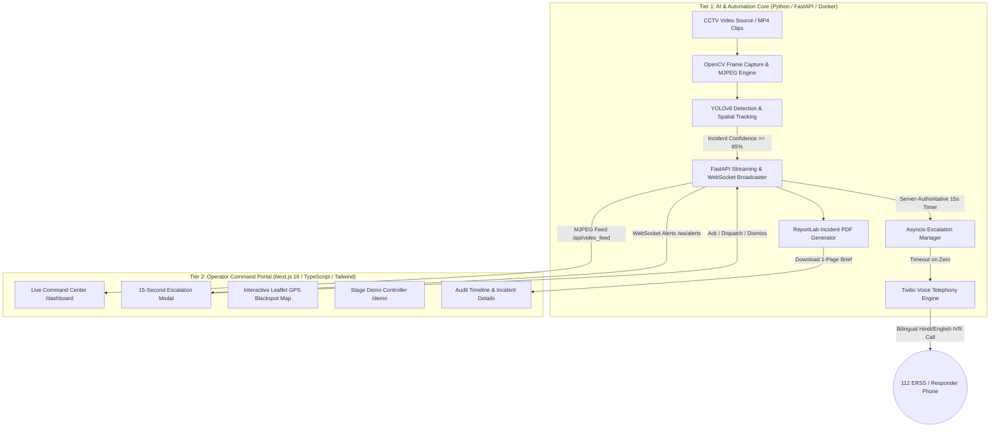

# 🚨 NetraGridAI — AI-Powered Smart City Emergency Dispatcher

<div align="center">


### **Transforming Municipal CCTV Streams into Zero-Latency Emergency Dispatch for India's 112 ERSS & Smart City ICCCs**

[](https://nextjs.org/)
[](https://react.dev/)
[](https://www.typescriptlang.org/)
[](https://tailwindcss.com/)
[](https://ultralytics.com/)
[](https://www.twilio.com/)
[](LICENSE)

[**Live Command Center**](#-live-operator-portal-routes) • [**Architecture**](#-system-architecture) • [**Stage Demo Walkthrough**](#-stage-demo-stunt-guide) • [**Quickstart**](#-quickstart-guide) • [**API Contract**](#-backend-api--websocket-contract)

</div>

---

## 📌 Problem Statement: The Lost "Golden Hour"

In India, road traffic accidents cause over **150,000+ fatalities annually**, with two-wheelers and vulnerable road users accounting for **over 44.5% of total casualties**. 

The single greatest bottleneck determining survival is the **loss of the critical "Golden Hour"**:
* ⏳ **Delayed Manual Reporting:** Emergency dispatch relies almost entirely on panicked bystanders or passersby dialling helplines, inflating incident-to-dispatch latency to **20+ minutes**.
* 📹 **Unmonitored Surveillance Infrastructure:** Municipalities invest millions in CCTV networks and Integrated Command and Control Centres (ICCCs), yet feeds sit largely archived or unmonitored due to acute human operator fatigue and staffing shortages.
* 🛑 **The "Bounding Box" Fallacy:** Standard computer vision hackathon projects detect an accident, draw a red box on a screen, and stop there. Without real-world operational escalation, software alerts fail to save lives.

> **NetraGridAI closes the loop.** It turns computer vision into real-world emergency action by pairing real-time video detection with a human-in-the-loop 15-second verification modal, falling back to an autonomous bilingual (Hindi/English) telephony dispatch to 112 emergency services and 108 CATS ambulances.

> **Repository status:** This repository currently contains the Next.js operator-console prototype, Supabase-backed operator sessions/configuration/incident records, and sample incident presets. The Python vision service, live WebSocket alerts, scheduled escalation worker, Twilio integration, and real emergency dispatch are not included or connected yet.

---

## 💡 The Solution & Core Value

NetraGridAI is an edge-computed, AI-driven CCTV surveillance and automated emergency response software designed for:
1. **Smart City Integrated Command and Control Centres (ICCCs)**
2. **India's 112 Emergency Response Support System (ERSS)**

```
┌─────────────────┐       ┌──────────────────────┐       ┌──────────────────────┐
│  CCTV Camera    │ ----> │ AI Vision Inference  │ ----> │  ICCC Operator       │
│  Live Stream    │       │ (YOLOv8 Spatial)     │       │  15s Decision Modal  │
└─────────────────┘       └──────────────────────┘       └──────────┬───────────┘
                                                                    │
                                            ┌───────────────────────┴───────────────────────┐
                                            ▼                                               ▼
                                 [Operator Acknowledges]                         [Timeout / Unhandled]
                                            │                                               │
                                            ▼                                               ▼
                                 Manual Dispatch to 112                      Automated Bilingual Twilio Call
                                 & CATS Ambulance Units                      Dispatched to First Responders
```

### Key Pillars
- **Zero-Latency Incident Detection:** Continuously tracks motorcycle falls, high-speed skids, and auto-rickshaw/vehicle rollovers with 85%+ confidence gating.
- **Human-in-the-Loop 15-Second Countdown:** Operators have 15 seconds to acknowledge, dispatch, or dismiss false positives.
- **Fail-Safe Telephony Voice Escalation:** If the operator fails to respond in 15 seconds, the backend autonomously initiates an outbound bilingual (Hindi & English) emergency call via Twilio.
- **Instant 1-Page Incident Brief PDF:** Auto-generates structured forensic briefs for traffic police and medical responders containing timestamps, GPS coordinates, and bounding-box snapshots.
- **Leaflet Command Map:** Visualizes high-risk accident blackspots, live incident pulses, and real-time response routes.

---

## 🏗️ System Architecture

NetraGridAI is engineered around a clean, decoupled 2-tier architecture ensuring ultra-low latency and stage-ready resilience:



### Component Breakdown

| Tier | Component | Technology / Library | Responsibility |
| :--- | :--- | :--- | :--- |
| **Tier 1 (Core)** | **Vision Model** | Python 3.11+, Ultralytics YOLOv8 | Lightweight inference tuned for Indian traffic dynamics (falls, slides, rollovers). |
| | **Video Engine** | OpenCV (`opencv-python-headless`) | Frame decoding, spatial annotation overlay, and MJPEG multipart stream encoding. |
| | **Backend API** | FastAPI + Uvicorn | Asynchronous REST endpoints, WebSocket `/ws/alerts`, and server-authoritative timers. |
| | **Telephony** | Twilio Programmable Voice | Programmatic outbound voice dispatch using inline TwiML with Hindi & English voice synthesis. |
| | **Reports** | ReportLab | Programmatic 1-page PDF incident brief generation with snapshot integration. |
| **Tier 2 (Portal)** | **Operator UI** | Next.js 16 (App Router), React 19 | High-contrast "mission control" interface with sub-millisecond state updates. |
| | **Styling** | Tailwind CSS v4, Lucide Icons | Accessible dark-theme UI with responsive layouts and WCAG AA contrast compliance. |
| | **Mapping** | Leaflet.js, React-Leaflet | GPS blackspot mapping, camera clustering, and incident geofencing. |
| | **Audio / Voice** | Web Audio API / Synthesis | Multi-frequency emergency alert klaxons and bilingual audio feedback. |

---

## ⚡ Core Features & Innovations

### 1. 🎯 Heterogeneous Indian Traffic Collision Inference
Standard Western traffic algorithms fail on chaotic, lane-less roads. NetraGridAI analyzes:
* **Aspect-Ratio Flip:** Rapid transformation of a vertical motorcycle/rider bounding box into a horizontal orientation.
* **Sudden Velocity Decay:** Deceleration profiles indicating abrupt impact or skidding.
* **Bounding Box Overlap:** Dynamic IoU (Intersection over Union) intersections between motorized vehicles and pedestrian/two-wheeler classes.

### 2. ⏱️ Server-Authoritative 15s Escalation Modal
* Countdown calculated via server timestamps (`deadlineTs - now()`), rendering the timer immune to browser refreshes or dropped connections.
* Color-coded progress ring (Cyan `15–6s`, Amber `5–3s`, Pulsing Red `<3s`).
* Keyboard accessibility shortcuts (`A` = Acknowledge, `D` = Dispatch, `Esc` blocked during active countdown).

### 3. 📞 Automated Telephony Voice Dispatch (Twilio)
* Outbound voice dispatch with synthesized bilingual emergency speech:
  * **Hindi:** *"आपातकालीन चेतावनी! राष्ट्रीय राजमार्ग 48 पर भीषण सड़क दुर्घटना पाई गई है। तुरंत एम्बुलेंस भेजें।"*
  * **English:** *"Emergency Alert! Severe collision detected at National Highway 48, Gurugram Express Corridor. Immediate ambulance dispatch requested."*
* Live UI status tracking: `Queued` ➔ `Ringing` ➔ `Answered` ➔ `Completed`.

### 4. 🗺️ Leaflet Command Map & Blackspot Geofencing
* Dark-mode satellite & vector mapping with GPS blackspot markers.
* Pulsing incident beacons with click-through routing to forensic timelines.

### 5. 📄 1-Page Incident Brief PDF Generator
* Generates on-demand printable briefs for police investigation and EMS handoff:
  * High-resolution snapshot with bounding boxes.
  * GPS coordinates and camera metadata.
  * Precise collision timestamp, estimated impact velocity, and AI confidence.
  * Full dispatch log (Twilio Call SID, duration, responder trunk).

---

## 🖥️ Live Operator Portal Routes

The NetraGridAI portal provides a dedicated operator console built for long shifts:

| Route | Page | Purpose | Access |
| :--- | :--- | :--- | :--- |
| `/login` | **Operator Sign-in** | Secure authentication into ICCC network with sector assignment. | Public |
| `/dashboard` | **Live Command Center** | Primary operator screen: live MJPEG feed, active incidents, mini-map, telemetry. | Operator |
| `/demo` | **Stage Demo Console** | Deterministic hackathon stage stunt controls, phone override, and event logs. | Presenter / Judge |
| `/incidents` | **Incident Audit Ledger** | Filterable history of all detected, acknowledged, and escalated events. | Operator |
| `/incidents/:id` | **Incident Dossier** | Comprehensive forensic report, spatial evidence, and 1-page PDF export. | Operator |
| `/map` | **Full Command Map** | Full-viewport geospatial view of city cameras, blackspots, and response corridors. | Operator |
| `/cameras` | **CCTV Camera Grid** | Multi-camera health telemetry, frame rates, and stream resolution status. | Operator |
| `/settings` | **Dispatch Configuration** | Escalation timer thresholds (5–60s), language selection, and responder numbers. | Supervisor |
| `/about` | **Problem & Architecture** | Public briefing highlighting Indian road safety statistics and tech architecture. | Public |

---

## 🎬 Stage Demo Stunt Guide

NetraGridAI includes a **Stage Demo Console** (`/demo`) that creates sample incidents from bundled camera presets:

1. **Create an Account:** Use **Sign up** on `/login` with your name, email, and password. Confirm the email if confirmation is enabled.
2. **Request Operator Access:** New accounts have the `pending` role. An administrator must grant `operator`, `supervisor`, or `admin` before sign-in can access the console.
3. **Access Demo Console:** Navigate to `/demo` via the sidebar.
4. **Trigger an Incident:** Click **Trigger Collision Alert Now**. The server stores the sample incident in Supabase and sets its response deadline from the persisted dispatch configuration.
5. **Review the Incident:** A countdown is shown from the database deadline. Acknowledge, dismiss, or record a dispatch request before expiry.

> Demo incidents use bundled sample evidence. Expiry records an `AUTO-ESCALATED` state using a database-checked deadline; this repository does **not** yet run a background dispatch worker or place live Twilio/112 calls.

---

## 🚀 Quickstart Guide

### Prerequisites
* **Node.js** (v20.9.0 or later)
* **npm** or **pnpm**
* A Supabase project with the SQL migration applied.

### 1. Clone & Install Dependencies

```bash
# Clone the repository
git clone https://github.com/SparshChaurasia/NetraGridAI.git
cd NetraGridAI

# Install frontend dependencies
npm install
```

### 2. Configure Environment Variables

Create a `.env.local` file in the project root with the project URL and publishable key from Supabase:

```env
NEXT_PUBLIC_SUPABASE_URL=https://your-project.supabase.co
NEXT_PUBLIC_SUPABASE_PUBLISHABLE_KEY=your-supabase-publishable-key
```

Apply `supabase/migrations/20261018000000_operator_auth_and_incidents.sql` in the Supabase SQL Editor. Enable email sign-ups in Supabase Auth to use the in-app registration form and configure the allowed redirect URLs/email confirmation policy in the Supabase dashboard. New accounts receive a `pending` profile and cannot access incidents until an administrator approves them.

Promote the first supervisor/admin from the SQL Editor (replace the email and sector):

```sql
update public.profiles
set role = 'admin', assigned_sector = 'Sector 4 - Gurugram Express Corridor (NH-48)'
where id = (select id from auth.users where email = 'admin@example.com');
```

The same statement can assign `operator` or `supervisor` roles. The account email address must be confirmed when confirmation is enabled. Sessions are stored in an HTTP-only, secure-in-production cookie and refreshed through Supabase Auth. The browser never receives a service-role key.

### 3. Run the Development Server

```bash
npm run dev
```

Open [http://localhost:3000](http://localhost:3000) in your browser to launch the portal.

### 4. Build for Production

```bash
npm run build
npm start
```

---

## 🔐 Supabase-Backed Operator APIs

The current Next.js API routes use Supabase Auth and the authenticated user's JWT for database access. The SQL migration creates the `profiles`, `dispatch_config`, and `incidents` tables, enables row-level security, and exposes database functions for incident creation and state transitions. `PATCH /api/incidents/:id` is serialized in Postgres; repeating the same action returns the existing state, and every action is checked against the persisted deadline.

The dashboard polls persisted incidents while open and submits an escalation transition after the displayed deadline. The database validates the deadline, but a scheduled worker is still required to perform escalation while no operator browser is connected. There is no connected voice provider, so `AUTO-ESCALATED` and `DISPATCHED` are stored workflow states—not confirmation that an emergency call was placed.

## 📡 Current API Routes

| Endpoint | Method | Description |
| :--- | :--- | :--- |
| `/api/auth` | `GET / POST / DELETE` | Restore, sign in, register, and sign out a Supabase Auth session. |
| `/api/config` | `GET / PUT` | Read persisted dispatch configuration; supervisor/admin only may update it. |
| `/api/incidents` | `GET / POST` | List incidents or create a sample incident with a deadline generated by the database. |
| `/api/incidents/:id` | `PATCH` | Idempotent acknowledge, dismiss, dispatch-request, or due-escalation transition. |
| `/api/cctv` | `GET` | List local sample CCTV files. |
| `/api/video` | `GET` | List bundled demo clips. |

Live inference, MJPEG streaming, `/ws/alerts`, health telemetry, background escalation, PDF generation, and telephony routes are not implemented in this repository.

---

## 🎨 Design System & Visual Direction

NetraGridAI features a high-contrast, dark-mode **"Mission Control"** aesthetic designed to eliminate operator eye strain while making critical emergency alerts unmistakable:

| Token | Hex | Role & Purpose |
| :--- | :--- | :--- |
| **Void** | `#0A0F1C` | Page background providing maximum depth. |
| **Surface** | `#121A2E` | Base card and panel surface. |
| **Surface Raised** | `#1A2540` | Interactive modals, inputs, and popovers. |
| **Border** | `#26335A` | Crisp 1px structural dividers. |
| **Signal Cyan** | `#22D3EE` | Brand identity, primary action buttons, focus rings. |
| **Critical Red** | `#EF4444` | High-severity collision alerts, countdown `<5s`, manual dispatch. |
| **Warning Amber** | `#F59E0B` | Unacknowledged incidents, telephony calling state. |
| **Success Green** | `#22C55E` | Verified incidents, completed calls, healthy system telemetry. |

---

## 👥 Hackathon Team & Acknowledgments

Built with ❤️ for the **Smart City ICCC & India's 112 ERSS Emergency Response Hackathon**.

* **Core Innovation:** Closed-loop automated emergency response from CCTV feeds.
* **Special Thanks:** Open-source maintainers of Ultralytics YOLOv8, Leaflet, Next.js, and Twilio.

---

<div align="center">
  <sub>NetraGridAI © 2026. Designed for India's Smart Cities & Rapid Emergency Response Support Systems.</sub>
</div>
